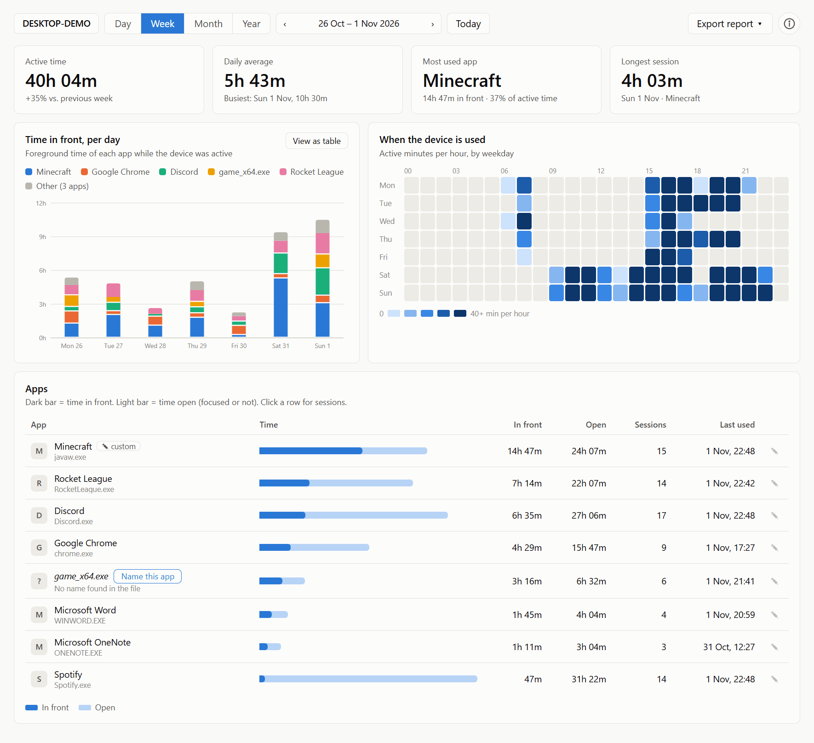
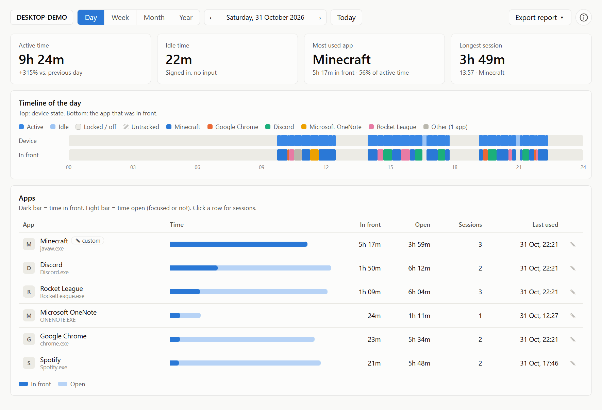
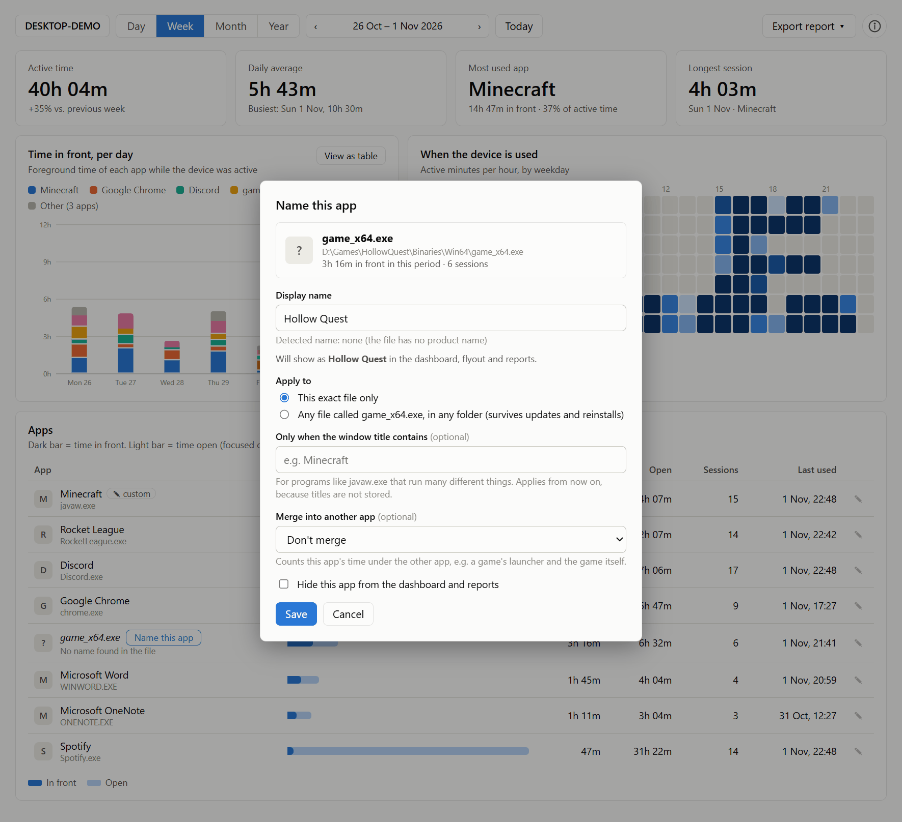
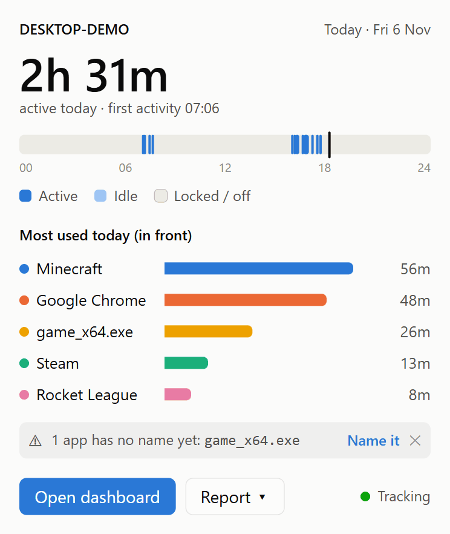
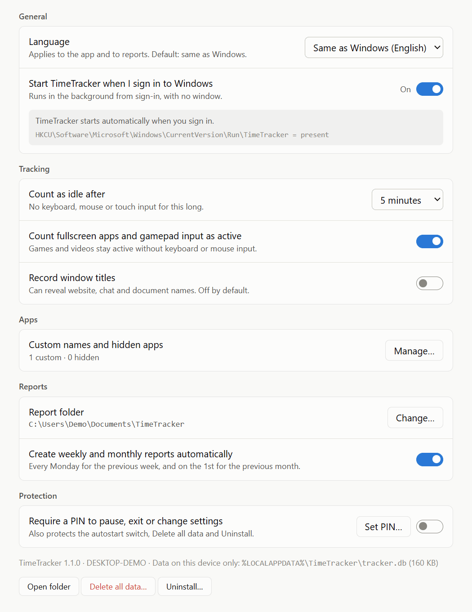

# TimeTracker

A small Windows 11 tray app that quietly records **how long the PC is used** and **which apps are open or in front**, and shows it as a flyout, a dashboard (day / week / month / year) and weekly or monthly reports. English and German. Everything stays on the PC; nothing is sent anywhere.

It is built for **self-monitoring and transparency**: the clock icon is always visible in the tray, and the person using the PC can open the dashboard at any time. It is not a hidden spyware-style tracker, and it does not try to hide from the user.

> **License:** this repository is public so anyone can see exactly what the app records, but it is **not open source**. All rights reserved, see [LICENSE](LICENSE). Third-party components: [THIRD-PARTY-NOTICES.md](THIRD-PARTY-NOTICES.md).

## Screenshots

*Demo data, shown in the light or dark style that matches your GitHub theme.*

**Dashboard, week view:** when the PC is used, which apps were in front, and how long each was open.

<picture>
  <source media="(prefers-color-scheme: dark)" srcset="docs/screenshots/dashboard-week-dark.png">
  
</picture>

**Day view:** a timeline of the day, with the device state on top and the app that was in front below.

<picture>
  <source media="(prefers-color-scheme: dark)" srcset="docs/screenshots/dashboard-day-dark.png">
  
</picture>

**Name an app:** programs whose file has no product name show as the raw `.exe`. Give them a name and it applies to all past data.

<picture>
  <source media="(prefers-color-scheme: dark)" srcset="docs/screenshots/name-an-app-dark.png">
  
</picture>

**Tray flyout:** one click on the tray icon.

<picture>
  <source media="(prefers-color-scheme: dark)" srcset="docs/screenshots/flyout-dark.png">
  
</picture>

**Settings:** autostart, idle threshold, language, reports and PIN.

<picture>
  <source media="(prefers-color-scheme: dark)" srcset="docs/screenshots/settings-dark.png">
  
</picture>

## Install

1. Get `TimeTracker.exe` (build it below, or from a release).
2. Double-click it and choose **Install**. No administrator rights are needed.
   - It copies itself to `%LOCALAPPDATA%\Programs\TimeTracker`, starts with Windows from then on, and appears in *Settings → Apps → Installed apps*.
   - There is no Start-menu or desktop shortcut and no taskbar button; only the tray icon.
3. Windows 11 may hide a new tray icon under the **^** arrow. Drag the clock icon out next to the Windows clock (or *Settings → Personalization → Taskbar → Other system tray icons*) to keep it visible.

Copy the same `TimeTracker.exe` to another PC and repeat. Each PC keeps its own data and shows its own Windows computer name.

**Uninstall:** *Settings → Apps → Installed apps → TimeTracker → Uninstall*, or TimeTracker → Settings → Uninstall. It asks whether to keep your recorded data.

## Updating to a new version

Send or copy the new `TimeTracker.exe` to the PC and **double-click it**. It recognises the installed version and offers **Update** (it tells you "from 1.0.0 to 1.1.0"). It stops the running tracker, replaces the program and starts it again, which takes a few seconds.

- **Your data and settings are kept.** They live in `%LOCALAPPDATA%\TimeTracker` (database, settings, custom names, PIN), separate from the program in `%LOCALAPPDATA%\Programs\TimeTracker`, and the updater never touches them.
- **If a new version changes the database layout,** the data is upgraded in place, and a consistent backup (`tracker.db.pre-vN.bak`) is made first. If anything fails, the change is rolled back and the old data stays usable. The three newest backups are kept.
- **Older version over a newer one:** the installer warns you. If the newer version had already changed the data format, the older app refuses to open the data (and tells you to update) rather than risk damaging it. Nothing is deleted.
- **Do not copy the new exe over the installed one by hand.** The installed file is locked while TimeTracker runs. Just double-click the new exe; it handles this.
- A *Run once without installing* option is also offered, for trying a build without touching the installed one.

## Using it

| | |
|---|---|
| **Left-click the icon** | Flyout: today's active time, a day strip, the most used apps. |
| **Right-click the icon** | Open dashboard · Generate report · Pause tracking · Settings · Exit. |
| **Dashboard** | Day / Week / Month / Year. Time in front per day, when the device is used (weekday × hour), and a table with time **in front** vs. time **open**. Click a row for its sessions. The **(i)** button shows version, author and credits. |
| **Name an app** | Apps whose file has no product name show as the raw `.exe` (for example `game_x64.exe`). Click **Name this app** or the pencil to give it a name. It applies to all past data. You can also merge two exes (launcher + game), match any file with that name in any folder, or hide an app. |
| **Reports** | *Generate report* writes a self-contained `.html` (print it to PDF from the browser) and a `.csv` to `Documents\TimeTracker`. Weekly and monthly reports can be created automatically. |
| **Settings** | Language (English / Deutsch / same as Windows), start with Windows, idle threshold (default 5 min), fullscreen and gamepad count as active, window titles (off by default), report folder, PIN. |

**PIN:** with a PIN set, Pause, Exit, Settings (including the autostart switch), Delete all data and Uninstall ask for it. It stops casual changes. It cannot stop someone who ends the process in Task Manager; any time the tracker was not running appears as *Untracked* on the day timeline.

## What is measured

- **Active:** the session is unlocked and there was keyboard, mouse, touch or gamepad input within the idle threshold (a fullscreen foreground app also counts as active).
- **Idle:** signed in, no input for longer than the threshold. Shown, but not counted as active.
- **Locked / off:** locked, asleep, logged off or shut down. **Untracked:** the tracker was not running (crash, Exit, pause, autostart off).
- **In front:** the app owning the foreground window while the device is active. Over a day, in-front time adds up to active time.
- **Open:** the app has a visible window (focused or not) while the session is unlocked.

Window titles are **not** recorded unless you switch that on. No keystrokes, no screenshots, no network access.

## Where things are

| | |
|---|---|
| Program | `%LOCALAPPDATA%\Programs\TimeTracker\TimeTracker.exe` |
| Data (SQLite), backups and log | `%LOCALAPPDATA%\TimeTracker\tracker.db`, `*.bak`, `log.txt` |
| Reports | `Documents\TimeTracker` (changeable) |
| Autostart | `HKCU\Software\Microsoft\Windows\CurrentVersion\Run\TimeTracker` |

## Build from source

Needs the [.NET 10 SDK](https://dotnet.microsoft.com/download). The result runs on Windows 10/11 without installing .NET (self-contained); the screens need the WebView2 runtime, which is part of Windows 11.

```powershell
powershell -ExecutionPolicy Bypass -File .\build.ps1      # runs the tests, writes dist\TimeTracker.exe (about 48 MB)
```

Layout: `src/TimeTracker.Core` (database, collector, statistics, reports, web UI assets), `src/TimeTracker` (Windows integration), `tests/`, `tools/`, `docs/` (proposal and design, UI mocks).

Developing: run `dotnet run --project src/TimeTracker -- --dev` with the environment variable `TIMETRACKER_DATA` pointing at a scratch folder so your real data is untouched (an instance with its own data folder has its own lock, so it can run next to an installed copy). `tools/seed_demo.py` fills a scratch database with sample usage. Other developer switches: `TIMETRACKER_DEVICE_NAME` (override the shown computer name), `TIMETRACKER_NO_COLLECT=1` (no live recording), `TIMETRACKER_NO_OPEN=1` (never open files or folders), `TIMETRACKER_DEVTOOLS=1`. The screenshots above were made this way: demo data, device name `DESKTOP-DEMO`, no live recording.

### Releasing a new version

1. Change `<Version>` in [Directory.Build.props](Directory.Build.props) and add a [CHANGELOG.md](CHANGELOG.md) entry.
2. If the database layout changes: add a **new** entry at the end of `Db.DefaultMigrations` (never edit an old one) and a test in `MigrationTests.cs`. Without a layout change nothing else is needed.
3. Run `build.ps1` (tests must pass), tag the commit (for example `v1.2.0`) and attach `dist\TimeTracker.exe` to a GitHub release. Do not commit `dist/`.

## Troubleshooting

- *No icon:* check the **^** overflow. *Windows asks "Install" every time:* you started the downloaded copy instead of the installed one (the tray icon means it is already running).
- *Windows says the app is blocked:* the exe is not code-signed. *More info → Run anyway*, or right-click → Properties → Unblock.
- *Blank window:* the WebView2 runtime is missing (Windows 10): install it from https://go.microsoft.com/fwlink/p/?LinkId=2124703.
- Logs: `%LOCALAPPDATA%\TimeTracker\log.txt`.

## Credits

Written by Pieter Walsweer, built with [Claude Code](https://claude.com/claude-code) (Anthropic) as the coding engine. © 2026 Pieter Walsweer. All rights reserved.
